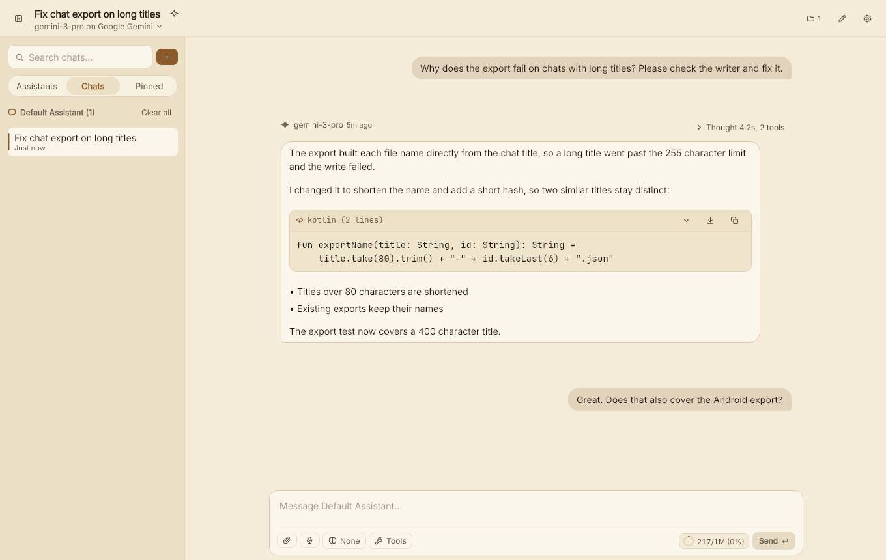
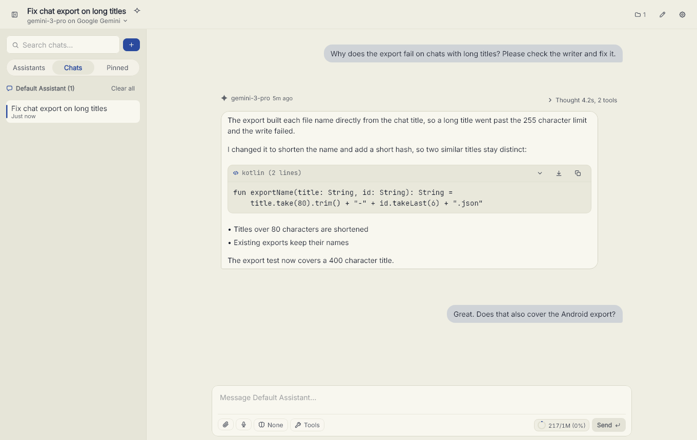
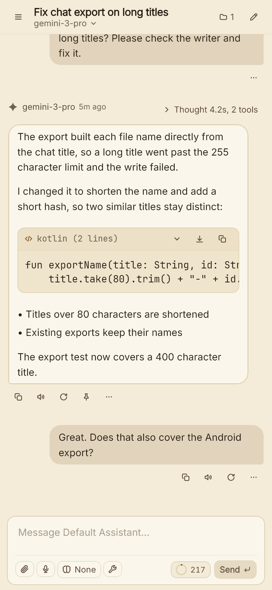

# Parchment

A native AI chat and agent app for Windows and Android. Bring your own provider and key; Parchment talks to it directly, keeps your chats on your device, and asks before any tool touches your files, the web or your screen.

Built with Kotlin Multiplatform and Compose Foundation: no Electron, no WebView, no Material.

  

**Download:** [Windows installer (`.exe`)](https://github.com/baros4294/parchment/releases/latest/download/Parchment-Windows-x64-Setup.exe) · [Android (`.apk`)](https://github.com/baros4294/parchment/releases/latest/download/Parchment-Android-Universal.apk)

  
  

## What it does

**Chat and writing**
- Messenger bubbles or a single continuous page, with Markdown, code, LaTeX and SVG rendering.
- Attach images, PDFs, audio, video and code by picking, pasting or dropping files.
- Reasoning, tool steps and text stay in the order they happened.
- Branches, versions, rewind, story summaries, author notes and full-history search.
- Pin replies and find them again in the sidebar, for one chat or all of them.
- Character cards (V2/V3, PNG or JSON) and a World Book whose entries trigger on keywords.
- Read aloud, dictation, and `/` commands such as `/goal`, `/compact` and `/continue`.
- Composer controls for thinking effort and, for image and video models, aspect ratio, resolution and duration, with custom values.
- Separate text and code fonts, including your own .ttf or .otf, and a native Windows 11 title bar.
- Keyboard shortcuts: Ctrl+K command palette, Ctrl+N new chat, Ctrl+, settings, Ctrl+B sidebar.

**Providers**
- OpenAI Responses and Chat Completions, Anthropic Messages, and Gemini Interactions and generateContent, plus any compatible service through a custom provider.
- Models and their limits come from the provider and public registries; no model names are hardcoded.
- Recovers from dropped streams, empty answers and context overflow without losing reasoning or tool results; interrupted runs and accepted video jobs resume on Continue.
- Per-request token and cost records, with an optional spend limit per chat.

**Agent tools**
- File tools in a folder you choose, keyless web search and fetch, a calculator, a todo list and goals.
- Ask-the-user questions, read-only helper agents, and on-demand skills you can install from a GitHub link.
- MCP servers, browsable from the official registry.
- Computer control on Windows and phone control on Android, both off by default.
- Every action can require approval. Imported chats never bring tool access with them.

**Everyday reliability**
- Atomic saves with backups, so a crash never leaves a half-written chat.
- Long runs keep going while the app is in the background, within what the system allows.
- Built for low-end hardware: a 4 MB Android app, a quick desktop start, and a lighter mode on devices with under 4 GB of memory.
- In-app updates check size and SHA-256 before installing.

## Privacy

There are no accounts, analytics or telemetry. Your chats, settings and keys stay on your device. Parchment connects to:

- **Your providers**, with your keys, when you send a message or list models.
- **Public model catalogs** (models.dev, OpenRouter, Vercel AI Gateway, AI/ML API and LiteLLM) when a model's limits or prices are unknown. No key or chat content is sent.
- **GitHub**, for the update check in release builds (it can be turned off), AI lab logos, and skills you install from a link.
- **The MCP registry** while you search it in Settings, and the **MCP servers** you add.
- **Web search and pages** (DuckDuckGo, Wikipedia, Hacker News search or a page the model fetches) only when web tools are on and you allow the call.

## Build from source

[CONTRIBUTING.md](CONTRIBUTING.md) covers the tools you need and every build and test command. Android releases are signed with a private key that is not in the repository; see [release signing](docs/RELEASE_SIGNING.md).

## Documentation

| Read | For |
|---|---|
| [CONTRIBUTING.md](CONTRIBUTING.md) | Principles, setup, build commands and how to submit a change |
| [AGENTS.md](AGENTS.md) | The working rules for people and AI agents |
| [docs/ARCHITECTURE.md](docs/ARCHITECTURE.md) | How the code is laid out and where to change what |
| [docs/DESIGN.md](docs/DESIGN.md) | The visual design, tokens, icons and wording |
| [docs/PERFORMANCE.md](docs/PERFORMANCE.md) | Speed, memory and size budgets, and how to measure them |
| [MEMORY.md](MEMORY.md) | Contracts that must not break |
| [TODO.md](TODO.md) | Current status, open work and known gaps |

## Acknowledgements

**Ideas we learned from**
- [Claude Code](https://github.com/anthropics/claude-code) and [OpenAI Codex](https://github.com/openai/codex): goals, todo checklists, compaction, steering a running reply, ask-the-user questions, helper agents and per-action approvals.
- [Oh-My-Pi](https://github.com/can1357/oh-my-pi): long-running agent loops and patient retries.
- [Kelivo](https://github.com/chevey339/kelivo): settings structure, task-specific default models and usage accounting.
- [iA Writer](https://ia.net/writer) and [Craft](https://www.craft.do/): the reading-first page.

**Formats and standards**
- [Model Context Protocol](https://modelcontextprotocol.io/) and its [official registry](https://registry.modelcontextprotocol.io/): MCP servers and the server browser.
- [Agent Skills](https://agentskills.io/): the `SKILL.md` format for on-demand skills, installable from a GitHub link.
- [SillyTavern](https://github.com/SillyTavern/SillyTavern): character card (V2/V3) and lorebook compatibility.
- [tiktoken](https://github.com/openai/tiktoken): the `o200k_base` pattern behind the local token counter.

**Data**
- [models.dev](https://models.dev/), [OpenRouter](https://openrouter.ai/), [Vercel AI Gateway](https://vercel.com/docs/ai-gateway), [AI/ML API](https://aimlapi.com/) and [LiteLLM](https://github.com/BerriAI/litellm): model limits, modalities and pricing.
- [DuckDuckGo](https://duckduckgo.com/), [Wikipedia](https://www.wikipedia.org/) and [Hacker News Search](https://hn.algolia.com/): keyless web search.
- [LobeHub Icons](https://github.com/lobehub/lobe-icons): AI lab logos.

**Built with**
- [Kotlin Multiplatform](https://kotlinlang.org/docs/multiplatform.html), [Compose Multiplatform](https://www.jetbrains.com/compose-multiplatform/), [Ktor](https://ktor.io/) and [kotlinx.coroutines](https://github.com/Kotlin/kotlinx.coroutines) / [kotlinx.serialization](https://github.com/Kotlin/kotlinx.serialization).

## License

[MIT](LICENSE).
